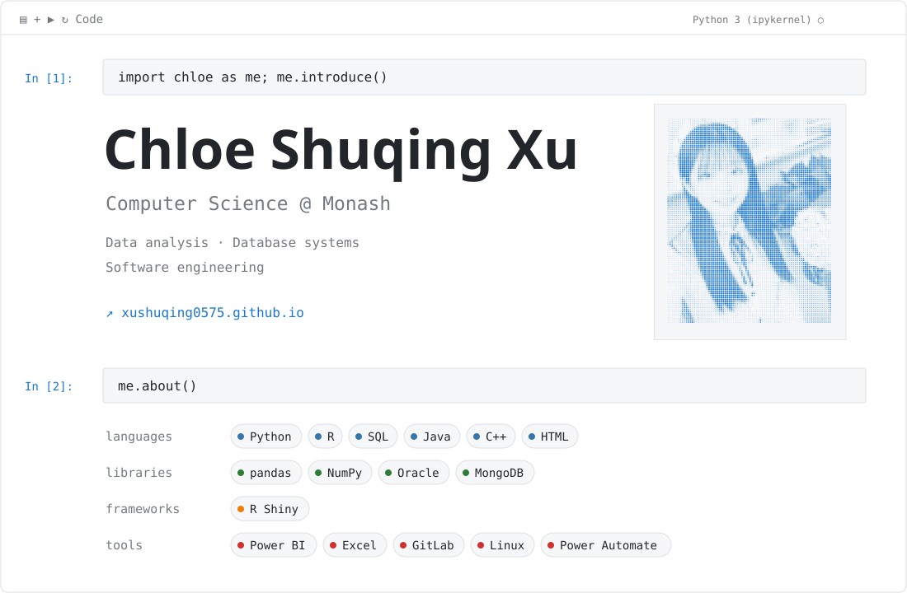

<picture>
  <source media="(prefers-color-scheme: dark)" srcset="notebook-dark.svg">
  
</picture>

[Portfolio](https://xushuqing0575.github.io/) · [Email](mailto:xushuqing0575@163.com) · [GitHub](https://github.com/xushuqing0575)

### Selected work

| Project | Focus | Tools |
| --- | --- | --- |
| Superstore Economic Dashboard | Retail data integration and interactive analysis | R, Shiny, tidyverse, Plotly |
| Campus Exploration & Rewards | Greedy graph exploration and reward retrieval | Python, BST, Max Heap |
| BigRig Mover | Transport database design and reporting; volunteer context | Oracle SQL, MongoDB, JSON |
| Farm & Roguelike | Team game with farming and environmental systems | Java, OOP, SOLID, REST API |

Computer Science student at Monash University, interested in data analysis and software engineering opportunities.
