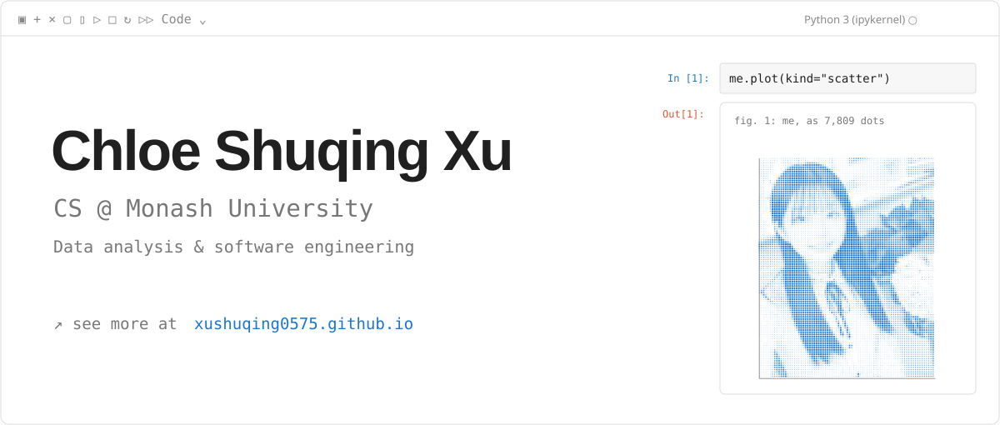
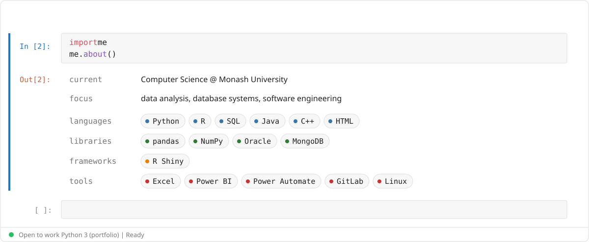

<a href="https://xushuqing0575.github.io/"><picture><source media="(prefers-color-scheme: dark)" srcset="header-dark-v4.svg"></picture></a>

<a href="mailto:xushuqing0575@163.com"><picture><source media="(prefers-color-scheme: dark)" srcset="button-email-dark-v3.svg"></picture></a>
<a href="https://xushuqing0575.github.io/"><picture><source media="(prefers-color-scheme: dark)" srcset="button-site-dark-v3.svg"></picture></a>
<a href="mailto:xushuqing0575@gmail.com"><picture><source media="(prefers-color-scheme: dark)" srcset="button-gmail-dark-v3.svg"></picture></a>

<a href="https://xushuqing0575.github.io/#ABOUT"><picture><source media="(prefers-color-scheme: dark)" srcset="about-dark-v3.svg"></picture></a>
